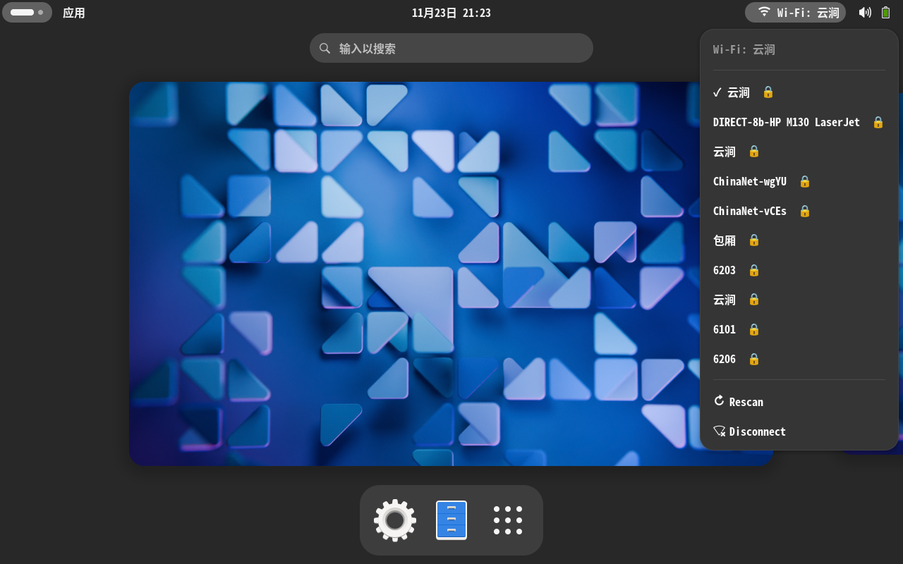

# nm-freebsd

**Languages:** [English](README.md) | [简体中文](README.zh-CN.md)

Repository: <https://github.com/Nickhades/network-rs>

> ### Security warning: do not install this on a multi-user system yet
>
> This MVP has no polkit and no SecretAgent. Full control is granted only to
> root and members of the `wheel` and `network` groups; other local users get
> read-only access. The desktop user must be in one of those groups:
> `pw groupmod network -m <user>` (then log out and back in).
> The daemon runs as root and can change machine-wide Wi-Fi settings.
> Saved Wi-Fi passphrases live in `/var/db/nm-freebsd/keyring.json` (mode 0600)
> separately from profiles, but they are **not encrypted at rest**: root can
> read them. Do not install this on a shared, multi-user or hostile-local-user
> machine until polkit/SecretAgent support lands.

A native FreeBSD implementation of the NetworkManager D-Bus service, written in
Rust. The daemon owns `org.freedesktop.NetworkManager` on the system bus and
serves the object tree that desktop frontends already understand. Real network
operations stay in FreeBSD: wpa_supplicant for Wi-Fi, netlink for links and
events, getifaddrs/resolv.conf for the addresses and DNS that are currently
configured.

The design rule is simple: **make the existing frontend work; do not write a
new desktop UI except where the desktop has no usable NetworkManager client.**
Upstream plasma-nm and the GNOME network panel use libnm/NetworkManagerQt and
need those client libraries at build time; FreeBSD's current packages are
built without them. XFCE gets a small panel plugin, and GNOME gets a Shell
extension, both of which are raw D-Bus clients and work without libnm.

```
plasma-nm / GNOME network panel / XFCE panel plugin
                     |
          system bus: org.freedesktop.NetworkManager
                     |
   +-----------------+------------------+
   |  zbus object layer                 |
   |  Manager, Device(.Wireless/.Wired),|
   |  AccessPoint, Settings,            |
   |  Settings.Connection, Active,     |
   |  IP4Config                        |
   +-----------------+------------------+
                     |
        core state + activation state machine
            /                       \
   wpa_supplicant                 FreeBSD netlink
   D-Bus or datagram ctrl         link dump/events
   socket                         getifaddrs + resolv.conf
```

## Version history

- **v0.1.0** — initial NetworkManager compatibility MVP; kept as a historical
  archive tag.
- **v0.2.0** — Phase 1 security hardening and Phase 2 DHCP; historical.
- **v0.2.1** — Phase 3 signal regression plus signal-driven XFCE panel;
  historical.
- **v0.2.2 / main** — NM contract fixes (Device.Disconnect,
  AddAndActivateConnection2), ActiveConnection adoption, activation
  serialization/profile dedupe, and GNOME/XFCE frontend fixes.

## Status

Working, tested MVP on FreeBSD 15.1-RELEASE (amd64):

- end-to-end integration test against a private D-Bus daemon and a fake
  wpa_supplicant control socket;
- mock `fi.w1.wpa_supplicant1` integration test proving
  `RequestScan -> Interface.Scan -> ScanDone -> BSSs -> AccessPoint`;
- read-only validation against a live `wlan0` and the base-system
  wpa_supplicant (real scan returned nearby APs, real IPv4 address and DNS were
  published through IP4Config);
- XFCE panel plugin builds as a `libxfce4panel-2.0` module, loads in a real
  `xfce4-panel` under an isolated Xvfb display, and renders the status button
  and network menu (screenshots below);
- Phase 1 security hardening: `wheel`/`network` D-Bus policy, per-caller uid
  checks, and a separate 0600 keyring for Wi-Fi passphrases;
- Phase 2 DHCP: base `dhclient` by default, optional `dhcpcd`, existing system
  dhclient reuse, exit-hook lease events, IP4Config gateway, and wired DHCP
  (process/hook paths are simulated in tests; a live root DHCP test remains
  manual);
- Phase 3 signal regression: standard `PropertiesChanged` on Device/AP/
  IP4Config, AP `Strength` changes, and a Device `StateChanged` sequence
  ending at `ACTIVATED`;
- one-click install, dependency check, compile/test, read-only smoke test and
  isolated desktop-test scripts are included.

It has **not** yet been run against a live plasma-nm or GNOME network panel on
FreeBSD. Those frontends are the next compatibility milestone; see
[Limitations](#limitations-and-roadmap).

## What is implemented

| Area | Implemented |
| --- | --- |
| Manager | device list, state/connectivity, enable/sleep, permissions, state and device signals |
| Device | type, state/reason, MTU, MAC, active connection, IP4Config, managed/autoconnect |
| Device.Wireless | access points, request scan, active AP, last scan, capabilities |
| AccessPoint | SSID (raw bytes), strength, frequency, flags, WPA/RSN flags |
| Settings | list/get/add/update/delete/reload connections, NewConnection/ConnectionRemoved |
| Settings.Connection | get settings/secrets, update, update-unsaved, delete, Updated/Removed |
| Connection.Active | state, default, devices, IP4Config, IDs |
| IP4Config | address data, gateway, nameservers, DNS data (read-only) |
| Wi-Fi backend | open, WPA2-PSK, WPA3-SAE, scanning, status, connect, disconnect |
| DHCP | base `dhclient` (default), optional `dhcpcd`, system-client reuse, exit-hook events, wired and Wi-Fi |
| Wired activation | ActivateConnection DHCP branch; link/address state and IP4Config |
| Transports | wpa_supplicant datagram control socket (default on FreeBSD), optional `fi.w1.wpa_supplicant1` D-Bus backend |
| Link events | netlink RTM_GETLINK dump + multicast monitor, getifaddrs polling fallback |
| Desktop | KDE/GNOME/XFCE/unknown detection and logging; XFCE panel plugin |
| Security | `wheel`/`network` D-Bus policy, per-caller uid checks, truthful GetPermissions, separate 0600 keyring |
| Packaging | D-Bus policy, activation service, rc.d script, port skeleton |

See [docs/DBUS.md](docs/DBUS.md) for signatures and frontend notes,
[docs/SCAN-FLOW.md](docs/SCAN-FLOW.md) for the exact RequestScan ->
Interface.Scan -> ScanDone -> BSSs chain, and
[docs/CODE-REVIEW.md](docs/CODE-REVIEW.md) for the review findings and accepted
risks. A bilingual documentation index is at [docs/README.md](docs/README.md).

## Important FreeBSD findings

These differ from the original architecture sketch and are handled in the code:

1. **Stock FreeBSD wpa_supplicant has no D-Bus interface.** The base-system
   binary is built without `CONFIG_CTRL_IFACE_DBUS`. The daemon therefore
   defaults to the native control interface, which on FreeBSD is a
   **`SOCK_DGRAM` Unix socket** requiring the client to bind its own path
   (verified with `truss(1)`). A D-Bus backend is still provided for
   ports/custom builds where `fi.w1.wpa_supplicant1` exists; `--backend auto`
   probes and falls back.
2. **The XFCE binding crate is named `xfce-panel`.** The upstream project is
   [xfce-panel-plugin-rs](https://github.com/d3v2a/xfce-panel-plugin-rs), but
   the published crates are `xfce-panel` and `xfce-panel-sys`. The plugin uses
   those.
3. **Desktop detection is local and tested.** The Linux-oriented
   `detect-desktop-environment` crate would add a dependency for reading two
   XDG variables. The same Kde/Gnome/Xfce/Unknown classification is implemented
   in `crates/nm-common/src/desktop.rs`, with unit tests and the same
   `XDG_CURRENT_DESKTOP` semantics.
4. **netlink is usable on FreeBSD 14+.** `crates/nm-freebsd-daemon/src/netlink.rs`
   speaks the FreeBSD wire layout directly, including FreeBSD's `sockaddr_nl`
   (which starts with a length byte, unlike Linux). If netlink is unavailable,
   interface list polling through getifaddrs keeps the daemon functional.
5. **The dhclient PID path is not `/var/run/dhclient.*.pid`.** FreeBSD uses
   `/var/run/dhclient/dhclient.<ifname>.pid`; the daemon checks that file and
   reuses a running rc.conf dhclient instead of forking a duplicate. The
   lease/exit events come from `/etc/dhclient-exit-hooks`, which
   `dhclient-script` sources after BOUND/RENEW/EXPIRE.
6. **Desktop frontends need a functional NM client library, not only the
   D-Bus service.** The installed `gnome-control-center` 47.7 package on this
   host has no `network` panel and does not link `libnm`;
   `networkmanager-shim` is a 5.9 KB build shim. Registering
   `org.freedesktop.NetworkManager` is necessary, but a prebuilt frontend that
   was compiled without NetworkManager support cannot grow a panel at runtime.
   A functional `libnm`/NetworkManagerQt and rebuilt desktop packages are the
   remaining Phase 4 prerequisite.

## One-click install and test

### Prebuilt installer (no Rust build)

The release artifacts are already built in `target/release`. From this
checkout, run:

```sh
sudo ./install-oneclick.sh
```

This installs the daemon, XFCE plugin, `nm-notify-dhcp`, D-Bus policy,
activation service, rc.d script and dhclient hook, then starts the service and
runs the smoke test. To install without starting:

```sh
sudo ./install-oneclick.sh --no-start --no-smoke
```

After installation, restart the panel and add the plugin:

```sh
xfce4-panel -r
# Panel → Add New Items → NetworkManager FreeBSD
```

Use `sudo ./uninstall-oneclick.sh` to remove it. The generated
`/etc/dhclient-exit-hooks` block is backed up/restored by the installer.

If smoke still reports that `org.freedesktop.NetworkManager` is unreachable,
the daemon may have failed to start or the bus policy was not reloaded. Check
`sudo tail -50 /var/log/nm_freebsd.log`, then run:

```sh
sudo service dbus restart
sudo service nm_freebsd start
sudo service nm_freebsd status
```

The installer now waits up to 30 seconds for the bus name before running smoke.
Run `service` status checks as root; the PID file is root-only.

### Build-and-install

```sh
sudo scripts/install.sh                  # deps check, build, install, enable/start, smoke
sudo scripts/install.sh --install-deps   # optionally install missing pkg deps first
sudo scripts/install.sh --with-plugin --install-deps  # force plugin + its deps
make test                                # fmt + clippy -D warnings + tests + release build
make desktop                             # isolated Xvfb/XFCE screenshot test
```

Useful variants:

```sh
scripts/check-deps.sh --with-plugin      # read-only dependency report
scripts/build-test.sh                    # writes build-test.log
scripts/smoke-test.sh --scan             # read-only check of a running service
sudo scripts/install.sh --no-start       # install files but do not start
sudo scripts/install.sh --destdir /tmp/stage --no-start --no-smoke
scripts/install.sh --uninstall --yes     # stop and remove installed files
```

The installer uses the files in `packaging/freebsd`, backs up existing policy,
service, rc and dhclient-hook files as `*.nm-freebsd.bak`, installs the
`nm-notify-dhcp` bridge and appends the DHCP exit-hook source line, enables the
rc service, applies the policy with `org.freedesktop.DBus.ReloadConfig` and runs
the smoke test.
If Rust comes from rustup under your user, the installer derives
`CARGO_HOME`/`RUSTUP_HOME` for the root build; for development, build as
yourself and pass `--no-build`. It never removes `/var/db/nm-freebsd` unless
`--uninstall --purge` is used.

## Desktop rendering test

`scripts/desktop-test.sh` creates a disposable environment: Xvfb on a free
display, a private session bus, a private system bus, a fake wpa_supplicant,
the real daemon and the real XFCE panel. It installs the plugin into a temporary
HOME, writes a one-panel xfconf configuration, clicks the plugin with XTest and
captures both states. Your :0 session and panel configuration are not touched.


The images show the real plugin loaded by `xfce4-panel` 4.20.8: the button
reads "Wi-Fi: Cafe WiFi"; the menu lists the fake APs with strength and lock
state plus Rescan/Disconnect. Logs are in
`artifacts/desktop-test/logs/`. The test needs `Xvfb`, `xfce4-panel`,
`xfce4-screenshooter`, XTest headers (`pkg install libXtst`) and a real
`wlan0` for device enumeration.

## GNOME Shell extension

The stock FreeBSD GNOME packages are built without libnm, so the native
gnome-shell/control-center network UI cannot appear just because the daemon
registers its D-Bus name.  `gnome-extension/` provides a raw D-Bus Shell
extension instead (GNOME 45+ ESM):

```sh
scripts/install-gnome-extension.sh
# or: make gnome-extension
```

It installs only for the current user under
`~/.local/share/gnome-shell/extensions/nm-freebsd@nickhades.github.io` and
adds the UUID to `org.gnome.shell enabled-extensions`.  Log out and back in,
or on X11 use `Alt+F2` then `r`.  It queries `GetDevices`,
`GetAllAccessPoints`, `AddAndActivateConnection`, and subscribes to
`StateChanged`, `AccessPointAdded/Removed` and AP `PropertiesChanged`; there
is no polling.



The screenshot was captured in an isolated Xvfb/nested GNOME Shell 47.10 with
a private session bus and the real system-bus daemon.  Extension state was
`enabled=true`, `error=""`.

## Build

Requirements:

- FreeBSD 15.x (14.x should work; netlink is required for live events but the
  daemon falls back to polling);
- Rust 1.95 or newer (the XFCE binding requires edition 2024 / 1.95);
- `pkgconf`, GTK 3 and libxfce4panel 2.0 development files for the plugin;
- D-Bus (system bus) and wpa_supplicant for runtime.

```sh
cargo build --release -p nm-freebsd-daemon
cargo build --release -p nm-xfce-plugin   # optional, requires XFCE dev libs
cargo test --workspace
```

The daemon binary is `target/release/nm-freebsd-daemon`; the DHCP hook
bridge is `target/release/nm-notify-dhcp`. The plugin is
`target/release/libnm_freebsd_xfce.so`; its generated desktop file lives under
`target/release/build/nm-xfce-plugin-*/out/nm_freebsd_xfce.desktop`.

## Run

The daemon must run as root: FreeBSD's wpa_supplicant control socket is
`root:wheel` mode 0770 and netlink link configuration needs privilege.

For a quick private-bus smoke test (does not touch the system bus policy):

```sh
# terminal 1: a private bus
dbus-daemon --config-file=/path/to/permissive-system.conf --nofork

# terminal 2
DBUS_SYSTEM_BUS_ADDRESS=unix:path=/path/to/bus \
  sudo -E target/release/nm-freebsd-daemon \
    --backend wpa-ctrl --wpa-ctrl-dir /var/run/wpa_supplicant
```

For production install the files from `packaging/freebsd`:

```sh
install -m 755 target/release/nm-freebsd-daemon /usr/local/bin/
install -d /usr/local/libexec
install -m 755 target/release/nm-notify-dhcp /usr/local/libexec/
sed 's|%%PREFIX%%|/usr/local|g' packaging/freebsd/libexec/nm-freebsd-dhcp-hook.in \
  > /usr/local/libexec/nm-freebsd-dhcp-hook
install -d /usr/local/etc/dbus-1/system.d /usr/local/share/dbus-1/system-services
install -m 644 packaging/freebsd/etc/dbus-1/system.d/org.freedesktop.NetworkManager.conf \
  /usr/local/etc/dbus-1/system.d/
sed 's|%%PREFIX%%|/usr/local|g' \
  packaging/freebsd/etc/dbus-1/system-services/org.freedesktop.NetworkManager.service.in \
  > /usr/local/share/dbus-1/system-services/org.freedesktop.NetworkManager.service
sed 's|%%PREFIX%%|/usr/local|g' packaging/freebsd/etc/rc.d/nm_freebsd \
  > /usr/local/etc/rc.d/nm_freebsd
chmod 755 /usr/local/etc/rc.d/nm_freebsd
service dbus restart
sysrc nm_freebsd_enable=YES
service nm_freebsd start
```

The one-click installer also installs `nm-notify-dhcp` and appends the DHCP
source line. For a manual install, add it yourself:

```sh
printf '\n. /usr/local/libexec/nm-freebsd-dhcp-hook\n' >> /etc/dhclient-exit-hooks
```

The port skeleton is in
`packaging/freebsd/ports/net-mgmt/nm-freebsd`; see
[packaging/freebsd/README.md](packaging/freebsd/README.md). The port's
`cargo-crates.mk` is generated from `Cargo.lock` by
[tools/gen-port-crates.py](tools/gen-port-crates.py).

### Daemon options

```
--backend auto|wpa-ctrl|wpa-dbus   wpa_supplicant transport (default auto)
--dhcp-backend auto|dhclient|dhcpcd  DHCP client (default auto, prefers base dhclient)
--dhcp-timeout SECONDS             wait for a lease before CONNECTED_SITE (default 30)
--wpa-ctrl-dir PATH                default /var/run/wpa_supplicant
--state-dir PATH                   profile storage, default /var/db/nm-freebsd
--wifi-interface NAME              repeatable; auto-detected wlan* otherwise
--no-wired                         do not expose Ethernet interfaces
--bus system|session               default system
--bus-address ADDRESS              explicit D-Bus address (jails/tests)
--desktop auto|kde|gnome|xfce|unknown
--no-initial-scan                  skip the startup Wi-Fi scan
--log-level FILTER                 env NM_FREEBSD_LOG also works
```

## Desktop behaviour

- **KDE / GNOME:** the daemon starts no UI. Native plasma-nm / GNOME panels
  require a functional libnm and packages rebuilt with NetworkManager support;
  the stock FreeBSD GNOME packages do not include that client. The included
  GNOME Shell extension in `gnome-extension/` talks to the service directly
  over D-Bus instead.
- **XFCE:** after the port is installed with the XFCE option enabled,
  "NetworkManager FreeBSD" appears in *Panel → Add New Items*. The plugin only
  needs D-Bus; it shows the
  current state, scans on demand, lists networks, asks for a WPA passphrase and
  calls `AddAndActivateConnection`.
- **Unknown:** D-Bus only; the daemon logs a hint. Set `XDG_CURRENT_DESKTOP` or
  `--desktop` for headless images.

The XFCE plugin is session-scoped and the daemon is system-scoped. Every plugin
request opens a fresh system-bus connection, so restarting the daemon does not
require restarting the panel.

## Profile storage

Profiles are small JSON documents in `/var/db/nm-freebsd/connections/*.json`
(directory 0700, files 0600). Only fields this daemon can apply are persisted:
UUID, id, type, SSID (byte array), key management, autoconnect and timestamp.
Passphrases are stored separately in `/var/db/nm-freebsd/keyring.json` (0600),
keyed by profile UUID; older profiles with a plaintext `psk` are migrated on
startup and rewritten without it. The D-Bus settings dictionaries are
reconstructed from those fields. Secrets are never logged.

## Security

The installed policy grants **full method access only to root and members of
`wheel`/`network`**, and the daemon independently checks the caller uid for
every mutating method it implements (activation, settings writes, secrets,
enable/sleep); unprivileged `Properties.Set` is blocked by the policy.
Unprivileged local users can read manager/device/AP properties, list saved
connections without secrets, and request scans. `Properties.Set` and
`GetSecrets` are denied to them by policy and daemon checks.
`GetPermissions` resolves the caller uid and returns `yes`/`no` truthfully
(scan is allowed for everyone; control operations are not).

There is still no polkit and no SecretAgent. A desktop user who is not in
`wheel` or `network` gets a read-only UI; grant control with:

    pw groupmod network -m <user>

then log out and back in. For multi-user or hostile-local-user systems, do not
install this MVP yet; wait for the polkit/SecretAgent phase. The keyring is a
separate 0600 file, but it is **not encrypted at rest** and root can read it.
Do not expose the system bus to untrusted machines. Treat
`/var/db/nm-freebsd` as secret.

## Limitations and roadmap

Deliberately out of scope for this MVP:

- DHCP is implemented through `dhclient` (default) or optional `dhcpcd`.
  The daemon starts a managed client when no system instance exists, otherwise
  it reuses the existing one. Exit hooks report BOUND/RENEW/REBIND/EXPIRE.
  A lease timeout (default 30 s) leaves the device in IP_CONFIG and degrades the
  manager to CONNECTED_SITE rather than claiming a usable IP.
- No IPv6 (`IP6Config` is `/`), no DHCPv6, no DHCP option objects, no secret agent,
  no polkit, no VPN, no enterprise (802.1X), no WEP, no hidden-network UI.
- No automatic activation of saved profiles. wpa_supplicant's own configured
  networks may still associate; the daemon will report that state.
- A Wi-Fi link that was already up when the daemon started is reported as
  `CONNECTED_SITE` with no `ActiveConnection` object until an activation is
  performed through the daemon.
- Access points are only removed when a non-empty scan no longer contains them;
  an empty scan result preserves the previous list to avoid flicker.
- The XFCE plugin is signal-driven (standard NetworkManager signals) with a
  30-second fallback poll; it reconnects its signal listener after daemon
  restarts.
- Live plasma-nm and GNOME panel testing is still pending. The installed
  GNOME Control Center was built without the network panel and the available
  `networkmanager-shim` is a stub; a functional libnm/rebuilt desktop package
  is required before those panels can appear.

## Repository map

```
crates/nm-common/          constants, desktop detection, SSID/security helpers
crates/nm-freebsd-daemon/  daemon, D-Bus objects, wpa_ctrl/wpa_dbus, netlink, DHCP
  tests/integration.rs     private bus + fake wpa/clients end-to-end test
crates/nm-dhcp-notify/     dhclient-exit-hooks -> Dhcp.Notify bridge
crates/nm-xfce-plugin/     XFCE panel plugin (cdylib)
scripts/                   install, deps, build-test, smoke-test, desktop-test
packaging/freebsd/         policy, activation service, rc.d, port skeleton
tools/                     fake wpa server, port crate-list generator
artifacts/desktop-test/    panel/menu screenshots and logs
docs/                      English architecture, D-Bus, scan flow, FreeBSD, testing, review
docs/zh-CN/                Chinese mirrors of the same documents
gnome-extension/           raw D-Bus GNOME Shell extension
install-oneclick.sh        prebuilt root installer (no Rust build)
uninstall-oneclick.sh      remove the installed files
Makefile                   convenience targets for the scripts
```

## License

BSD-2-Clause. See [LICENSE](LICENSE).
